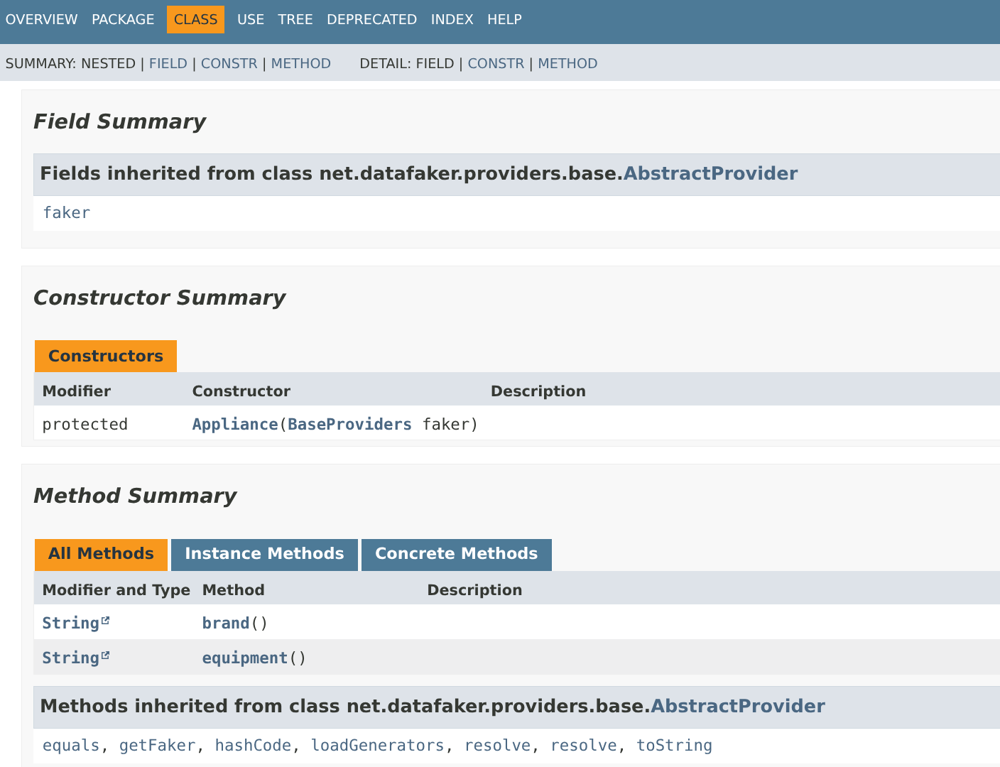

# Documentation de la demo p6spy et datafaker

## Introduction

Une partie importante de la performance et de la robustesse d'une application
reside dans sa couche d'acces aux donnees et dans le dialogue avec la base de donnnees.
Dans ce contexte diposer d'un outil nous permettant de suivre le dialogue application <-> base de donnees
est un besoin crucial.
Ce document presente une famille d'outils remplissant ce besoin : les proxies JDBC.
Il introduit brievement aussi une librairie Java **Datafaker** ayant pour but de simplifier la
generation de donnees de test.

## Le besoin

Il suffit de quelques requetes sous optimales pour faire basculer un ressenti utilisateur et eventuellement remettre en  cause
un developpement entier. Ainsi disposer d'un outil *espionnant* le trafic entre application et base de donnees nous permet d'enivisager
un suivi fiable de ce dialogue et  de diagnostiquer les problemes.
Les fonctionnalites basiques attendues seront alors:
- voir les requetes echangees
- tracer les requetes problematiques
- identifier les parametres des requetes pouvant engendrer des soucis de performance


## Proxy JDBC 

Un driver JDBC de type proxy est un *faux driver JDBC* interpose entre l'applicatif et la base afin de capturer le dialogie
entre ces 2 composants.
Examinons le cas standard d'une application Java executant des requetes via JDBC.


Maintenant regardons l'impact  architectural de l'ajout d'un driver JDBC de type proxy.


La figure precedente montre clairement que l'on a interpose ce driver dans  la conversation entre l'application et la base.

Le driver proxy nous offre ainsi la possibilite de voir toutess les requetes circulant, d'eventuellement tracer les requetes les plus
gourmandes ou incompatibles avec nos engagements de service (*SLO*).

Ainsi dans le cas de la demonstration il va generer un fichier (*spy.log*) du type:

```
1793953194301|4|statement|connection 0|url jdbc:p6spy:postgresql://localhost:5432/bibliotheque|select a1_0.id,a1_0.date_naissance,a1_0.nom,a1_0.prenom,a1_0.pseudonyme from auteur a1_0 where character_length(a1_0.nom)>10|select a1_0.id,a1_0.date_naissance,a1_0.nom,a1_0.prenom,a1_0.pseudonyme from auteur a1_0 where character_length(a1_0.nom)>10
1793953194335|2|statement|connection 0|url jdbc:p6spy:postgresql://localhost:5432/bibliotheque|select a1_0.id,a1_0.date_naissance,a1_0.nom,a1_0.prenom,a1_0.pseudonyme from auteur a1_0 where a1_0.nom=? and a1_0.prenom=?|select a1_0.id,a1_0.date_naissance,a1_0.nom,a1_0.prenom,a1_0.pseudonyme from auteur a1_0 where a1_0.nom='toto' and a1_0.prenom='tata'
1793953194408|65|statement|connection 0|url jdbc:p6spy:postgresql://localhost:5432/bibliotheque|select a1_0.id,a1_0.date_naissance,a1_0.nom,a1_0.prenom,a1_0.pseudonyme from auteur a1_0 join livre l1_0 on l1_0.auteur_id=a1_0.id group by a1_0.id having count(l1_0.id)>?|select a1_0.id,a1_0.date_naissance,a1_0.nom,a1_0.prenom,a1_0.pseudonyme from auteur a1_0 join livre l1_0 on l1_0.auteur_id=a1_0.id group by a1_0.id having count(l1_0.id)>5

```
Chaque ligne de ce CSV contient les champs suivant (separes par le caractere |):
- timestamp de la requete
- duree d'execution de la requete
- type de requete
- connexion JDBC portant cette requete
- requete 

### mise en place
Pour la mise en place concrete (plus detaillee) se reporter au document dedie.

Nous allons ici  simplement commenter les fichiers importants:
- persistence.xml, fichier impose par la norme **JPA** et referencant les **persistence units** manipulees dans l'application
- spy.properties, la configuration du driver proxy 


Le fichier spy.properties utilise dans cette demonstration est le suivant:
``` java
modulelist=com.p6spy.engine.logging.P6LogFactory
  # adds this module to the previous line for outage!!
  #,com.p6spy.engine.outage.P6OutageFactory
driverlist=org.postgresql.Driver
logfile=spy.log
useNanoTime=true
append=false
# Log slow queries only
# uncomment to report slow queries (interval in seconds!!!)

#outagedetection=true
#outagedetectioninterval=1
```

On notera que:
- la detection de  requetes lentes est desactivee ici (*outagedetection*)
- le fichier genere est spy.log
- le format de sortie est celui par defaut (non precise) 

Le fichier centrall JPA est ici:
``` xml
<?xml version="1.0" encoding="UTF-8"?>
<persistence xmlns="https://jakarta.ee/xml/ns/persistence"
             xmlns:xsi="http://www.w3.org/2001/XMLSchema-instance"
             xsi:schemaLocation="https://jakarta.ee/xml/ns/persistence https://jakarta.ee/xml/ns/persistence/persistence_3_1.xsd"
             version="3.1">

  <persistence-unit name="bibliotheque" transaction-type="RESOURCE_LOCAL">
    <provider>org.hibernate.jpa.HibernatePersistenceProvider</provider>
    <class>dev.bibliotheque.domaine.Auteur</class>
    <class>dev.bibliotheque.domaine.Livre</class>
    <exclude-unlisted-classes>true</exclude-unlisted-classes>

    <properties>
      <!-- URL, utilisateur et mot de passe sont fournis par le programme (voir Options) -->
      <property name="jakarta.persistence.jdbc.driver" value="org.postgresql.Driver"/>

      <!-- crée les tables auteur et livre si elles n'existent pas -->
      <property name="hibernate.hbm2ddl.auto" value="update"/>

      <!-- insertion groupée : regroupe les INSERT par lots de 50 et par table -->
      <property name="hibernate.jdbc.batch_size" value="50"/>
      <property name="hibernate.order_inserts" value="true"/>
    </properties>
  </persistence-unit>

  <persistence-unit name="bibliotheque-spy" transaction-type="RESOURCE_LOCAL">
    <provider>org.hibernate.jpa.HibernatePersistenceProvider</provider>
    <class>dev.bibliotheque.domaine.Auteur</class>
    <class>dev.bibliotheque.domaine.Livre</class>
    <exclude-unlisted-classes>true</exclude-unlisted-classes>

    <properties>
      <!-- URL, utilisateur et mot de passe sont fournis par le programme (voir Options) -->
      <property name="jakarta.persistence.jdbc.driver" value="com.p6spy.engine.spy.P6SpyDriver"/>
      <property name="jakarta.persistence.jdbc.url" value="jdbc:p6spy:postgresql://localhost:5432/bibliotheque" />
      <property name="jakarta.persistence.jdbc.user" value="bibliotheque" />
      <property name="jakarta.persistence.jdbc.password" value="bibliotheque" />
    </properties>
  </persistence-unit>
</persistence>

```
Ce fichier manipule 2 **persistence-units** distinctes, pointant  sur la meme base de donnees mais via des drivers differents.
1. bibliotheque , qui passe  par le driver standard JDBC
2. bibliotheque-spy,  qui  utilise le driver proxy

Ceci afin de montrer qu'une application en production ne **devrait pas passer** par un driver proxy mais qu'il est  aise de prevoir pour les
autres  environnements (dev,tq..) la mise en place de ce driver proxy.
Dans le cas de la demonstration:
- l'alimentation de la base (via des donnees *fake*) est faite via le driver standard
- l'observation (en vue d'optimisation des requetes) est faite via le driver proxy


Cet extrait de la classe QueryData le montre clairement.
``` java
 public static void main(String[] args) {
        try (EntityManagerFactory emf =
                     Persistence.createEntityManagerFactory(
                             "bibliotheque-spy");) {
            EntityManager mgr = emf.createEntityManager();
            List<Auteur> auteursWithLongNames =
                    mgr.createNamedQuery("findByLargeNames")
                            .getResultList();

```

alors que la classe PopulateDb realisant l'alimentation utilise l'autre persistence-unit comme illustre ci-dessous:

``` java
 public static void main(String[] args) {
        Options options = Options.depuis(args, System.getenv());
        DonneesAleatoires donnees = new DonneesAleatoires(new Faker(Locale.FRENCH), Clock.systemDefaultZone());
        Instant debut = Instant.now();

        try (EntityManagerFactory emf =
                     Persistence.createEntityManagerFactory("bibliotheque", options.proprietesJpa())) {

            Resultat total = options.taillesDesLots().stream()
                    .map(taille -> insererLot(emf, donnees, taille, options.livresParAuteur()))
                    .reduce(Resultat.VIDE, Resultat::plus);

            Duration duree = Duration.between(debut, Instant.now());
            System.out.printf("Terminé : %d auteurs et %d livres insérés en %.1f s%n",
                    total.auteurs(), total.livres(), duree.toMillis() / 1000.0);
        }
    }
```

## Generation de donnees aleatoires

Cette demonstration utilise la librairie *Datafaker* pour generer des donnees alimentant la base:
- la table auteur est ainsi alimentee 
- la table livre utilise aussi des donnees aleatoires

Le contenu des  objets Auteur et Livre est genere via DataFaker en utilisant des methodes proposees par la classe *Faker* telles que firstName() ou lastName() comme le montre le code generant des instances d'Auteur :

``` java
 /** Un auteur adulte, avec un pseudonyme une fois sur deux. */
    public Auteur auteur() {
        LocalDate naissance = faker.timeAndDate().birthday(AGE_MIN, AGE_MAX);
        String pseudonyme = faker.bool().bool() ? faker.name().username() : null;
        return Auteur.nouveau(faker.name().lastName(), faker.name().firstName(), pseudonyme, naissance);
    }
```

*Datafaker* est riche en objets metier issus de nombreux domaines:
- adresses
- personnes
- animaux
- applications
- appliances (equipements)
- etc..

Parmi les 263 *Data Providers* fournis il y a de forte chances de trouver son bonheur.

Voici un extrait du Provider *Appliance* permettant de generer (si besoin) des equipements aleatoirement:




## Conclusions

Cette demonstration vise a montrer:
- quelques exemples de requetes JPA
- la mise en place d'un driver JDBC de type proxy (ici p6spy)
- comment generer des donnees aleatoires avec Datafaker
